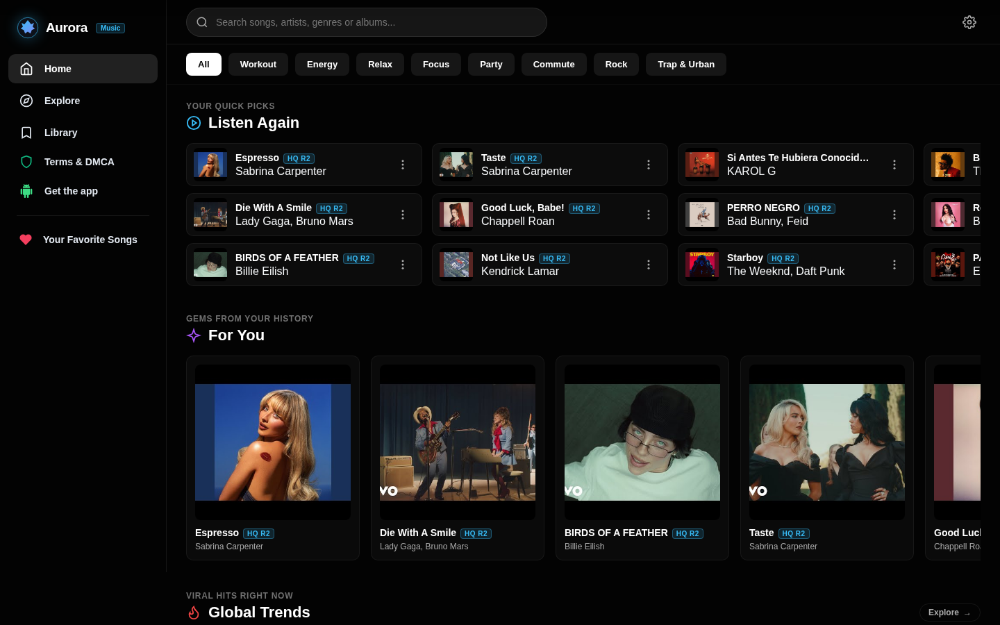
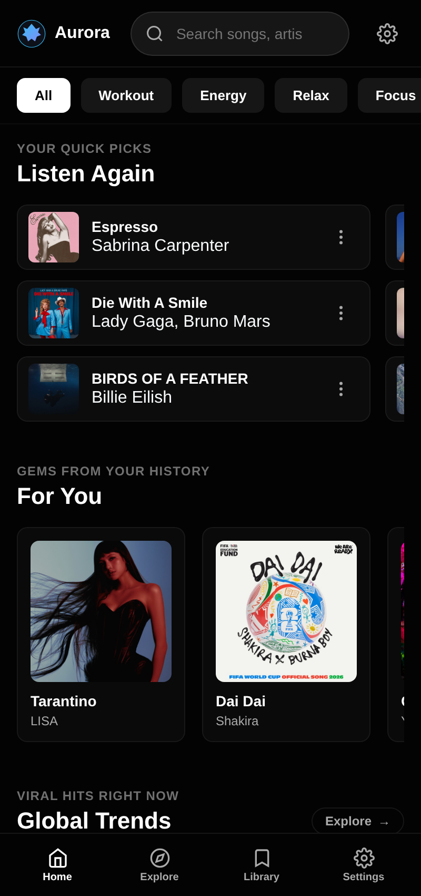
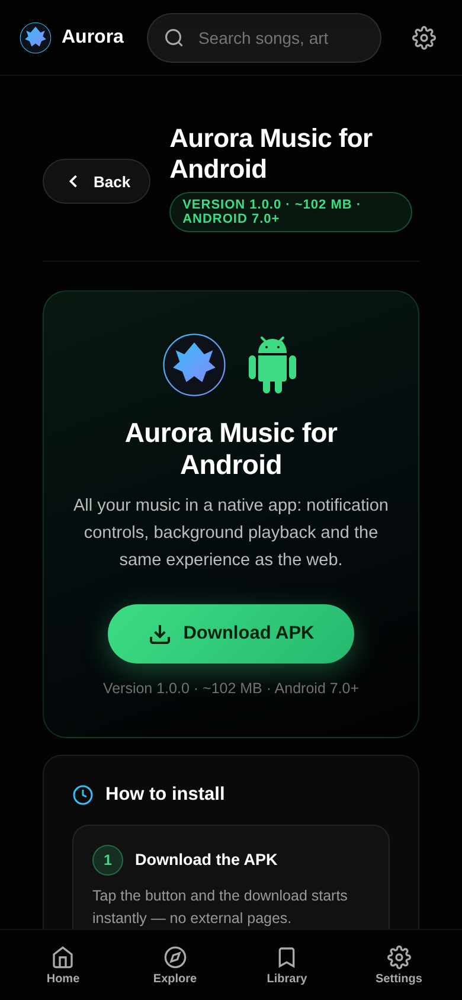
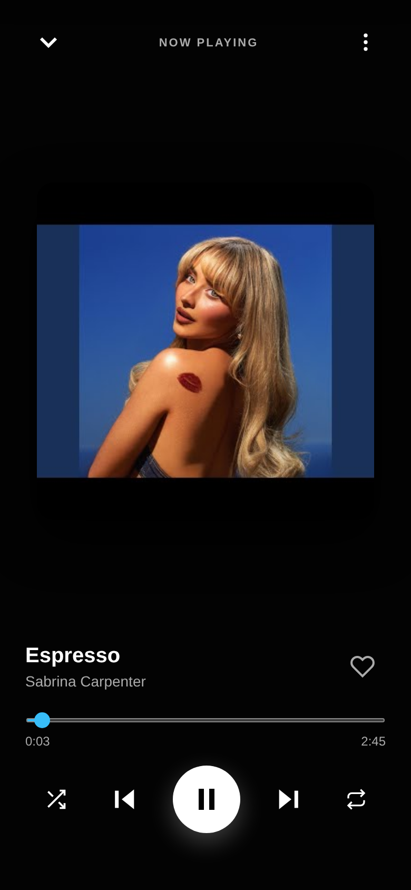
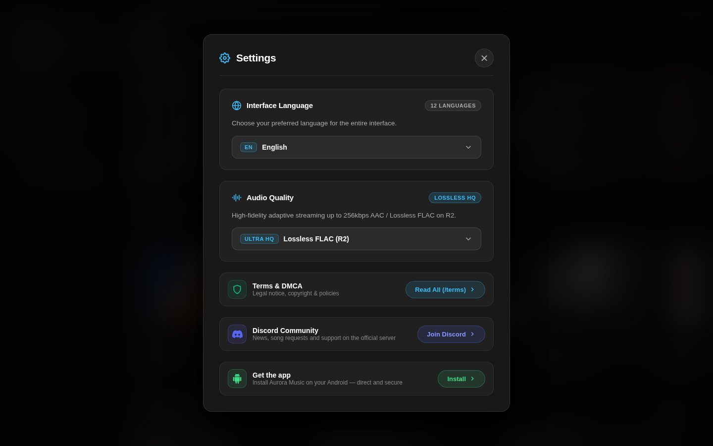

# 🎵 Aurora Music

**Sonic Stream Engine — free music streaming for the web & Android.**

Search and stream millions of tracks with a YouTube Music–powered engine,
high-fidelity audio and a clean, - in 12 languages.

**[🌐 Open the Web App](https://music.aurorax.site)** &nbsp;·&nbsp;
**[⬇️ Download for Android](https://github.com/DevAuroraX/Aurora-Music/releases/latest)** &nbsp;·&nbsp;
**[💬 Join the Discord](https://discord.gg/pU9ckzwsut)**

 &nbsp;&nbsp; 

---

## ✨ Features

- 🔎 **Powerful search engine** — finds songs, artists and albums through the YouTube Music engine
- 🎧 **High-fidelity streaming** — adaptive audio up to 256 kbps AAC and Lossless FLAC
- 🌍 **12 languages** — instant switching, no reload: English, Español, Português, Français, Deutsch, Italiano, Русский, 日本語， 한국어, 中文， العربية, हिन्दी
- ❤️ **Favorites & custom albums** — build your own collections, all stored privately on your device (IndexedDB)
- 🕘 **Playback & search history** — quick picks and recent searches, clearable at any time
- 🔔 **System media controls** — play/pause from the notification, lock screen or headphones (Media Session API)
- 📴 **Offline mode, YouTube Music style** — friendly skeletons and auto-recovery when the connection drops
- 📱 **Native Android app** — the full web experience with native media controls and downloads via the `AndroidBridge` interface
- 🎨 **Beautiful dark aurora UI** — YouTube Music–inspired layout, fully responsive, installable as a PWA

## 📱 Install on Android

Get the app directly — one tap, no mirrors, no external sites:

| | |
| --- | --- |
| 📦 **Package** | `com.aurora.music` |
| 🏷️ **Version** | 1.0.0 |
| 🤖 **Requires** | Android 7.0+ |
| 💾 **Size** | ~102 MB |
| 🔐 **Signature** | Signed release build |

1. **[⬇️ Download the APK](https://github.com/DevAuroraX/Aurora-Music/releases/latest/download/AuroraMusic.apk)** — the download starts immediately
2. **Open the downloaded file** from your notifications or the Files app
3. If Android asks, **allow installs from your browser/Files app** (normal for direct APK installs)
4. Tap **Install** — done. Enjoy Aurora Music with native media controls 🎶

> 💡 On iPhone, iPad or desktop? The full experience is also available on the web: **[music.aurorax.site](https://music.aurorax.site)**

## 🌐 The Web App

Open **[music.aurorax.site](https://music.aurorax.site)** in any browser — nothing to install.
You can also add it to your home screen as a PWA for an app-like experience.

This repository contains the complete source of the web app in [`web/`](web/):

- `web/aurora-music-worker.js` — the entire web app (HTML + CSS + JS) as a single Cloudflare Worker
- [`web/DEPLOY.md`](web/DEPLOY.md) — how to run your own instance

## 📸 Screenshots

| Web — Home (desktop) | Web — Home (mobile) | Get the app page |
| :---: | :---: | :---: |
|  |  |  |

| Now Playing | Settings & languages |
| :---: | :---: |
|  |  |

## 🛠 Tech Stack

- **Web:** Cloudflare Workers · D1 · R2 · YouTube Music engine · IndexedDB · Media Session API · PWA
- **Android:** Kotlin · Jetpack Compose · WebView + `AndroidBridge` JavaScript interface · Signed release build

## 🔗 Links

- 🌐 **Web app:** <https://music.aurorax.site>
- ⬇️ **Android APK:** <https://github.com/DevAuroraX/Aurora-Music/releases/latest>
- 💬 **Discord community:** <https://discord.gg/pU9ckzwsut>

---

**Made with 🎶 by [DevAuroraX](https://github.com/DevAuroraX)**

© Aurora Music — All rights reserved.

